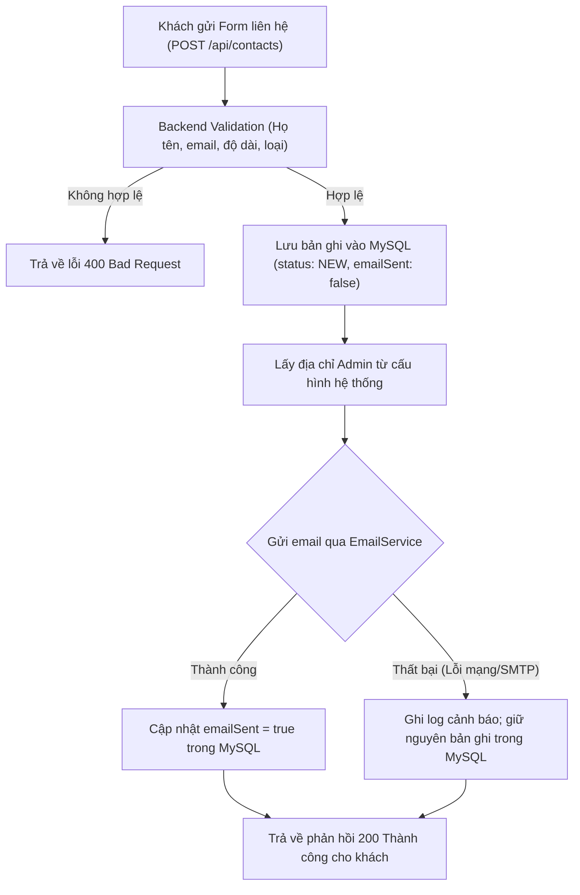

# BÁO CÁO BƯỚC 1: KIỂM TRA MÃ NGUỒN & THIẾT KẾ KỸ THUẬT PUBLIC WEBSITE

> **Dự án:** Library Management System – Hệ thống quản lý thư viện  
> **Giai đoạn:** Hoàn thiện Public Website (Khách vãng lai và độc giả công khai)  
> **Ngày lập:** 09/10/2026  
> **Trạng thái thực thi:** Bước 1 – Phân tích kỹ thuật, đối soát mã nguồn và lập kế hoạch hoàn chỉnh (Chờ phê duyệt trước khi chỉnh sửa mã nguồn).

---

## 1. KẾT QUẢ KIỂM TRA MÃ NGUỒN HIỆN TẠI

### 1.1. Hiện trạng Frontend
1. **React Router & Phân quyền (`App.jsx`, `RequireRole.jsx`):**
   - Tuyến đường `/` hiện đang kết nối tới trang tạm `LandingPage.jsx`.
   - Tuyến đường `/books` hiện đang bị chuyển hướng ép buộc: `<Route path="/books" element={<Navigate to="/user/books" replace />} />`.
   - Khu vực `/user/books` và `/user/books/:id` nằm hoàn toàn bên trong `<RequireRole role={["ROLE_USER", "ROLE_ADMIN"]}>`. Khách vãng lai (Guest chưa đăng nhập) khi truy cập `/books` hoặc `/books/:id` sẽ bị chặn và đẩy thẳng về `/login`.
2. **Khả năng tái sử dụng Component Sách (`BookCard.jsx`, `BookDetailPage.jsx`):**
   - `BookCard.jsx` hiện đang nhúng trực tiếp `<WishlistButton bookId={book.id} />`. Khi chạy ngoài khu vực `/user` (nơi không bọc `WishlistProvider`), hook `useWishlist` sẽ ném ngoại lệ Runtime: `WishlistProvider chưa được khởi tạo.`.
   - `BookDetailPage.jsx` chứa các hành động mượn sách (`CheckoutAction`), đặt giữ (`ReservationAction`) và nhận xét (`BookReviewsSection`). Các component này khi chạy mà không có phiên đăng nhập của người dùng sẽ tự động gọi các API xác thực (`/api/subscriptions/active`, `/api/book-loans/user`) dẫn đến lỗi `401 Unauthorized`.
3. **API Client (`src/api/client.js`, `src/api/books.js`):**
   - Đã hỗ trợ gửi request không kèm Authorization header khi `tokenStore.get()` trả về `null`.
   - Nếu máy chủ phản hồi `401 Unauthorized` khi người dùng là Guest (`token` rỗng), client không xóa phiên mà ném `ApiError(401, ...)`.

---

### 1.2. Hiện trạng Backend & Spring Security
1. **Rào cản lớn nhất tại Spring Security (`SecurityConfig.java`):**
   ```java
   // Hiện tại trong SecurityConfig.java:
   .requestMatchers(HttpMethod.POST, "/api/payments/webhook/payos").permitAll()
   // ... các route phân quyền ADMIN ...
   .requestMatchers("/api/**").authenticated() // <-- TẤT CẢ các API /api/* còn lại đều bắt buộc đăng nhập!
   .anyRequest().permitAll()
   ```
   - Các API đọc sách: `GET /api/books`, `POST /api/books/search`, `GET /api/books/{id}`, `GET /api/books/stats`
   - Các API thể loại: `GET /api/genres`, `GET /api/genres/{genreId}`
   - API gói thành viên: `GET /api/subscription-plans`
   - API đọc đánh giá: `GET /api/reviews/book/{bookId}`
   👉 **Hiện tại tất cả các endpoint trên đều bị chặn đối với khách chưa đăng nhập (trả về HTTP 401)**.
2. **Hiện trạng Module Contact trên Backend:**
   - **Chưa có module Contact:** Chưa có Entity `Contact`, chưa có bảng cơ sở dữ liệu `contacts`, chưa có Repository, Service hay Controller tiếp nhận liên hệ.
   - **Cơ sở hạ tầng Email đã sẵn sàng:**
     - File `pom.xml` đã tích hợp sẵn `spring-boot-starter-mail`.
     - File cấu hình đã có đầy đủ các thông số `spring.mail.*` (`host`, `port`, `username`, `password`, `smtp.auth`, `starttls`).
     - Đã có sẵn bean `EmailService` và `EmailServiceImpl` hoạt động ổn định (đang phục vụ chức năng quên mật khẩu).

---

## 2. PHÂN ĐỊNH PHẠM VI TRIỂN KHAI

| Khu vực | Chức năng | Khả năng thực hiện ngay | Phụ thuộc Backend cần phê duyệt |
| :--- | :--- | :---: | :---: |
| **Public Layout** | `PublicLayout`, `PublicNavbar`, `PublicFooter` | ✅ Thực hiện ngay | Không |
| **Trang chủ (Home)** | Hero section, quy trình mượn trả, CTA | ✅ Thực hiện ngay | Cần mở `permitAll()` cho `/api/books`, `/api/genres`, `/api/subscription-plans` |
| **Về chúng tôi (About)** | Giới thiệu sứ mệnh, công nghệ, hướng dẫn | ✅ Thực hiện ngay | Không |
| **Khám phá sách (Browse)** | Tìm kiếm, lọc thể loại, phân trang, xem chi tiết | ✅ Thực hiện ngay | Cần mở `permitAll()` cho `GET/POST /api/books/**`, `GET /api/genres/**` |
| **Chi tiết sách (Detail)** | Thông tin sách, đánh giá, dialog nhắc đăng nhập | ✅ Thực hiện ngay | Cần mở `permitAll()` cho `GET /api/books/{id}`, `GET /api/reviews/book/{id}` |
| **Liên hệ (Contact)** | Giao diện form, bản đồ Google Maps, validate | ✅ Xây dựng UI ngay | Cần xây dựng mới Module Contact Backend (MySQL + Email) |
| **Quản trị liên hệ (Admin)**| Danh sách liên hệ, xem chi tiết, đổi trạng thái | Chuẩn bị UI | Cần các API quản trị `/api/contacts/admin/**` |

---

## 3. THIẾT KẾ KỸ THUẬT MODULE CONTACT (PHƯƠNG ÁN 3: MYSQL + EMAIL)

### 3.1. Thiết kế Cơ sở dữ liệu MySQL (`contacts`)
- **Tên bảng:** `contacts`
- **Các trường dữ liệu:**
  - `id` (BIGINT, PRIMARY KEY, AUTO_INCREMENT): Khóa chính.
  - `full_name` (VARCHAR(100), NOT NULL): Họ và tên người gửi.
  - `email` (VARCHAR(150), NOT NULL): Địa chỉ email liên hệ.
  - `contact_type` (VARCHAR(30), NOT NULL): Loại liên hệ (`INQUIRY` - Câu hỏi, `FEEDBACK` - Góp ý, `BUG_REPORT` - Báo lỗi).
  - `subject` (VARCHAR(200), NOT NULL): Tiêu đề liên hệ.
  - `message` (TEXT, NOT NULL): Nội dung chi tiết.
  - `status` (VARCHAR(30), NOT NULL, DEFAULT 'NEW'): Trạng thái xử lý (`NEW`, `IN_PROGRESS`, `RESOLVED`).
  - `admin_notes` (TEXT, NULL): Ghi chú xử lý nội bộ của Quản trị viên.
  - `email_sent` (BOOLEAN, NOT NULL, DEFAULT FALSE): Trạng thái đã gửi email thành công cho Admin hay chưa.
  - `created_at` (DATETIME, NOT NULL): Thời điểm gửi liên hệ.
  - `updated_at` (DATETIME, NOT NULL): Thời điểm cập nhật trạng thái gần nhất.

### 3.2. Thiết kế REST API Hợp đồng (API Contract)
#### A. Dành cho Khách vãng lai (Public - `permitAll()`):
- **`POST /api/contacts`**
  - **Request Body:**
    ```json
    {
      "fullName": "Nguyễn Văn A",
      "email": "nguyenvana@gmail.com",
      "contactType": "INQUIRY",
      "subject": "Hỏi về thủ tục làm thẻ thư viện cho sinh viên",
      "message": "Em là sinh viên năm nhất muốn hỏi thủ tục mượn sách giáo trình..."
    }
    ```
  - **Response (200 OK):**
    ```json
    {
      "success": true,
      "message": "Liên hệ của bạn đã được gửi thành công. Quản trị viên sẽ phản hồi qua email trong thời gian sớm nhất."
    }
    ```

#### B. Dành cho Quản trị viên (ADMIN - `hasRole("ADMIN")`):
- **`GET /api/contacts/admin`**: Tra cứu danh sách liên hệ (Hỗ trợ phân trang `page`, `size`, lọc theo `status`, lọc theo `contactType`, tìm kiếm từ khóa `keyword`).
- **`GET /api/contacts/admin/{id}`**: Xem chi tiết một liên hệ.
- **`PUT /api/contacts/admin/{id}/status`**: Cập nhật trạng thái (`status`: `NEW` / `IN_PROGRESS` / `RESOLVED`) kèm ghi chú xử lý (`adminNotes`).
- **`GET /api/contacts/admin/stats`**: Lấy thống kê số lượng (Tổng số, Mới, Đang xử lý, Đã giải quyết).

### 3.3. Quy trình Xử lý & Gửi Email An toàn (Resilient Flow)

> **Nguyên tắc an toàn:** Dù gửi email có gặp trục trặc mạng hoặc thông tin SMTP tạm thời quá tải, bản ghi liên hệ vẫn được lưu an toàn trong MySQL để Admin xem được trên trang quản trị. Khách không bị báo lỗi sai lệch khi dữ liệu thực tế đã vào hệ thống.

---

## 4. ĐỀ XUẤT ĐIỀU CHỈNH SPRING SECURITY (`SecurityConfig.java`)

Để kích hoạt khu vực Public cho khách vãng lai duyệt sách và gửi liên hệ, đề xuất bổ sung các cấu hình sau vào `SecurityConfig.java`:

```java
// Cho phép Webhook PayOS và Gửi liên hệ công khai:
.requestMatchers(HttpMethod.POST, "/api/payments/webhook/payos", "/api/contacts").permitAll()

// Cho phép khách vãng lai đọc thông tin sách và thống kê:
.requestMatchers(HttpMethod.GET, "/api/books", "/api/books/*", "/api/books/stats").permitAll()
.requestMatchers(HttpMethod.POST, "/api/books/search").permitAll()

// Cho phép khách vãng lai đọc danh mục thể loại và gói cước:
.requestMatchers(HttpMethod.GET, "/api/genres", "/api/genres/*").permitAll()
.requestMatchers(HttpMethod.GET, "/api/subscription-plans").permitAll()

// Cho phép khách vãng lai đọc nhận xét, đánh giá sách:
.requestMatchers(HttpMethod.GET, "/api/reviews/book/*").permitAll()

// Module Quản lý liên hệ dành riêng cho ADMIN:
.requestMatchers("/api/contacts/admin", "/api/contacts/admin/**").hasRole("ADMIN")
```
*(Tất cả các quyền can thiệp dữ liệu như mượn sách, đặt giữ, thêm/sửa/xóa sách, thanh toán, quản lý tài khoản đều giữ nguyên mức bảo mật `authenticated()` và `hasRole("ADMIN")`).*

---

## 5. THIẾT KẾ KIẾN TRÚC FRONTEND PUBLIC

### 5.1. Bố cục Routes (`App.jsx`)
```
/                     -> PublicLayout > HomePage (Trang chủ thư viện)
/about                -> PublicLayout > AboutPage (Giới thiệu)
/contact              -> PublicLayout > ContactPage (Liên hệ & Góp ý)
/books                -> PublicLayout > PublicBooksPage (Khám phá sách công khai)
/books/:id            -> PublicLayout > PublicBookDetailPage (Chi tiết sách công khai)
```
- Khách truy cập các trang trên mà không bị chuyển hướng tới `/login`.
- Nếu khách bấm **Mượn sách**, **Đặt giữ** hoặc **Thêm vào yêu thích**, hệ thống sẽ mở **Modal hướng dẫn thân thiện**: *"Vui lòng đăng nhập để sử dụng tính năng này"*, kèm nút chuyển hướng đến `/login` và ghi nhớ đường dẫn hiện tại (`state: { from: location }`) để sau khi đăng nhập xong, khách được tự động đưa trở lại cuốn sách đang xem.

### 5.2. Các Shared Components Public
1. **`PublicNavbar.jsx`:**
   - Logo "THƯ VIỆN SỐ" với biểu tượng sách nổi bật.
   - Menu điều hướng: *Trang chủ*, *Khám phá sách*, *Về chúng tôi*, *Liên hệ*.
   - Khối trạng thái:
     - Nếu chưa đăng nhập: Nút *Đăng nhập* (outlined) và *Đăng ký* (contained xanh `#1769ff`).
     - Nếu đã đăng nhập: Avatar kèm menu thả xuống với lối tắt vào *Khu vực bạn đọc* (`/user`) và *Trang quản trị* (`/admin`) nếu là Admin, kèm nút *Đăng xuất*.
   - Hỗ trợ Mobile Drawer đáp ứng màn hình nhỏ (375px, 768px).
2. **`PublicFooter.jsx`:**
   - Tone màu Dark Navy sang trọng `#102d62`.
   - Cột 1: Thông tin thương hiệu, sứ mệnh thư viện số.
   - Cột 2: Lối tắt khám phá (Trang chủ, Khám phá sách, Giới thiệu).
   - Cột 3: Dịch vụ bạn đọc & Hội viên (Đăng nhập, Đăng ký, Gói thành viên).
   - Cột 4: Thông tin liên hệ thật (Địa chỉ thư viện, Hotline, Email hỗ trợ, Giờ mở cửa phòng đọc).
   - Chân trang: Dòng thông tin bản quyền và niên khóa tốt nghiệp.

---

## 6. DANH SÁCH FILE DỰ KIẾN TẠO VÀ SỬA

### 6.1. Phía Backend (Chờ bạn phê duyệt riêng):
1. **Tạo mới Model & Enum:**
   - `src/main/java/com/library/modal/Contact.java`
   - `src/main/java/com/library/modal/enums/ContactType.java` (`INQUIRY`, `FEEDBACK`, `BUG_REPORT`)
   - `src/main/java/com/library/modal/enums/ContactStatus.java` (`NEW`, `IN_PROGRESS`, `RESOLVED`)
2. **Tạo mới DTO:**
   - `src/main/java/com/library/payload/request/ContactRequest.java`
   - `src/main/java/com/library/payload/request/ContactStatusUpdateRequest.java`
   - `src/main/java/com/library/payload/response/ContactResponse.java`
3. **Tạo mới Repository & Service:**
   - `src/main/java/com/library/repository/ContactRepository.java`
   - `src/main/java/com/library/service/ContactService.java`
   - `src/main/java/com/library/service/impl/ContactServiceImpl.java`
4. **Tạo mới Controller:**
   - `src/main/java/com/library/controller/ContactController.java` (Public POST)
   - `src/main/java/com/library/controller/AdminContactController.java` (Admin quản lý)
5. **Cập nhật cấu hình bảo mật:**
   - `src/main/java/com/library/configrations/SecurityConfig.java` (Mở quyền công khai cho sách, thể loại, gói cước, nhận xét và gửi liên hệ).

### 6.2. Phía Frontend:
1. **Tạo mới Layout & Shared Components:**
   - `src/pages/PublicLayout/PublicLayout.jsx`
   - `src/pages/PublicLayout/PublicNavbar.jsx`
   - `src/pages/PublicLayout/PublicFooter.jsx`
2. **Tạo mới các trang Public:**
   - `src/pages/Home/HomePage.jsx` (Nâng cấp từ LandingPage với dữ liệu API thật của sách, thể loại, gói cước)
   - `src/pages/About/AboutPage.jsx` (Trang giới thiệu chuẩn đồ án thư viện số)
   - `src/pages/Contact/ContactPage.jsx` (Form liên hệ, thông tin thư viện, bản đồ)
   - `src/pages/PublicBooks/PublicBooksPage.jsx` (Khám phá sách công khai, an toàn cho Guest)
   - `src/pages/PublicBooks/PublicBookDetailPage.jsx` (Chi tiết sách công khai, dialog nhắc đăng nhập khi bấm mượn/đặt)
3. **Tạo mới API Client cho Contact:**
   - `src/api/contact.js`
4. **Tạo mới Trang Quản lý Liên hệ cho ADMIN (Phục vụ trọn vẹn đồ án):**
   - `src/pages/AdminLayout/AdminContactsPage.jsx`
   - Cập nhật `src/pages/AdminLayout/adminNavigation.js` và `AdminSidebar.jsx` để thêm mục menu "Liên hệ bạn đọc".
5. **Cập nhật Định tuyến (`App.jsx`):**
   - Đăng ký cụm route public dưới `PublicLayout`.
   - Kết nối route quản trị `/admin/contacts`.

---

## 7. YÊU CẦU PHÊ DUYỆT TỪ BẠN

Để tiến hành Bước 2 (Triển khai giao diện PublicLayout, Navbar, Footer) và các bước tiếp theo, xin bạn xác nhận phê duyệt:

1. **Phê duyệt thiết kế Backend Contact (Phương án 3):** Cho phép tạo Entity `Contact`, bảng MySQL `contacts`, Service gửi email thông báo Admin và Controller `ContactController`.
2. **Phê duyệt mở quyền Spring Security:** Cho phép cập nhật `SecurityConfig.java` để khách vãng lai có thể đọc sách, thể loại, gói cước, đánh giá và gửi form liên hệ qua các endpoint công khai.
3. **Thông tin liên hệ thực tế của thư viện:** Bạn muốn sử dụng thông tin liên hệ mẫu của Trường Đại học (ví dụ: Địa chỉ cơ sở, Email liên hệ, Số điện thoại hỗ trợ) hay thông số tùy chỉnh cụ thể nào?

